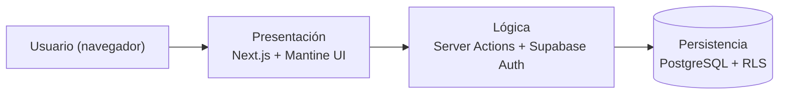

# Arquitectura

El sistema sigue un modelo **Cliente-Servidor en 3 capas**, sobre una arquitectura **Serverless / BaaS**.

## Capas

| Capa | Responsabilidad | Tecnología |
|---|---|---|
| **Presentación** | Interfaz responsiva, paneles por rol, formularios y grillas | Next.js (App Router), React, TypeScript, Mantine UI, Emotion |
| **Lógica / Servicio** | Validaciones de negocio, autenticación y control de acceso por rol (RBAC) | Next.js Server Actions, Supabase |
| **Persistencia** | Almacenamiento relacional y seguridad a nivel de fila | PostgreSQL en Supabase con Row Level Security (RLS) |

## Principios de diseño

- **Validación del lado del servidor:** las reglas críticas (DNI único, choques de horario, cupos) se validan en el servidor y en la base de datos, no solo en la interfaz.
- **Seguridad en profundidad:** el acceso se controla en tres niveles: ruta (panel por rol), Server Action (sesión y rol) y base de datos (RLS).
- **Atomic Design:** la interfaz se arma con átomos, moléculas, organismos y templates reutilizables. Ver [Guía de Frontend](Guia-de-Frontend).

## Estructura del código (resumen)

| Carpeta | Contenido |
|---|---|
| `src/app/` | Rutas (App Router), agrupadas por rol: `(admin)`, `(alumno)`, `(docente)`, `(tutor)`, `(no-docente)` |
| `src/components/` | Componentes reutilizables: `atoms`, `molecules`, `organisms`, `templates` |
| `src/features/` | Vistas funcionales de cada módulo |
| `src/lib/` | Utilidades y acceso a datos |
| `supabase/` | Migraciones del esquema de base de datos |

## Requerimientos no funcionales

| Código | Requerimiento |
|---|---|
| RNF-01 | Protección de datos mediante RLS |
| RNF-02 | Respuesta ≤ 3 segundos en consultas y reportes |
| RNF-03 | Persistencia en PostgreSQL en la nube |
| RNF-04 | Interfaz 100 % responsiva |
