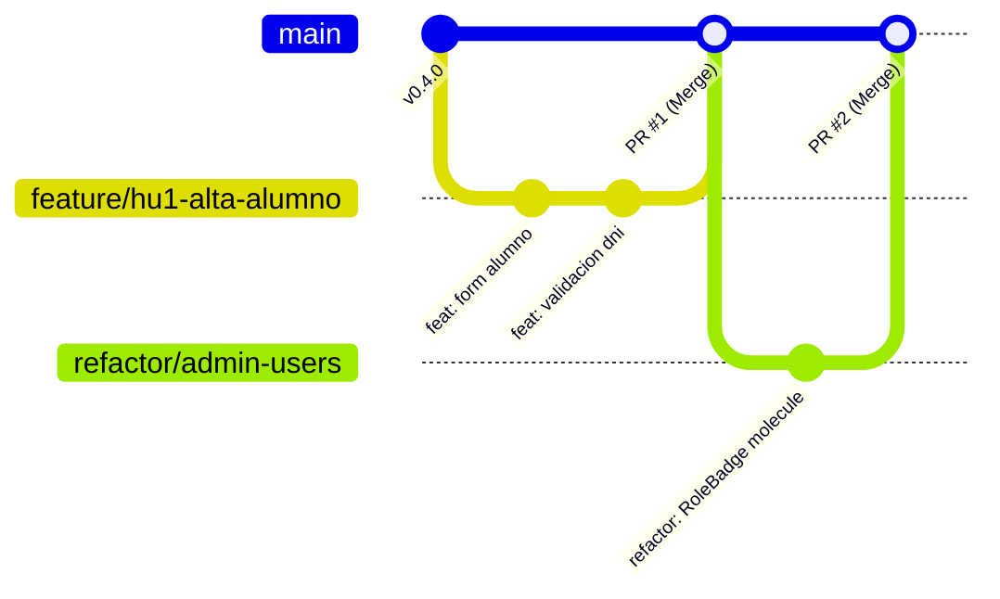

# Flujo de Trabajo y Gestión en GitHub

Este documento describe la metodología de colaboración, el ciclo de ramas en Git, la estructura del tablero en **GitHub Projects** y las convenciones adoptadas por el equipo.

---

## 1. Estrategia de Ramas (Git Flow Simplificado)

El repositorio utiliza un flujo basado en ramas funcionales con integración continua:



- **`main`:** Rama principal productiva. Siempre estable y lista para despliegue automático en Vercel.
- **Ramas de desarrollo secundarias:**
  - `feature/<nombre>`: Desarrollo de nuevas Historias de Usuario o funcionalidades (ej. `feature/hu3-reporte-consolidado`).
  - `refactor/<nombre>`: Mejoras de arquitectura o modularización sin cambios en la lógica de negocio (ej. `refactor/paneles-usuarios`).
  - `fix/<nombre>`: Corrección puntual de errores identificados en QA o producción.

---

## 2. Convención de Commits y Pull Requests

Los mensajes de commit siguen la especificación de **Conventional Commits**:
- `feat: <descripción>` para nuevas funcionalidades.
- `fix: <descripción>` para corrección de bugs.
- `refactor: <descripción>` para mejoras de estructura y modularización.
- `docs: <descripción>` para actualizaciones de documentación y wiki.
- `chore: <descripción>` para tareas auxiliares de configuración o dependencias.

### Vinculación de Pull Requests a Issues
Todo Pull Request debe indicar en su descripción el issue o Historia de Usuario que resuelve, permitiendo el cierre automático:
```markdown
Closes #1
```

---

## 3. Tablero Kanban (GitHub Projects)

El seguimiento de tareas se realiza sobre el tablero institucional del proyecto:
- **Campos personalizados:**
  - **Status:** `Todo` (Backlog), `In Progress` (En curso), `In Review` (QA / Code Review), `Done` (Completado).
  - **Iteration (Sprint):** Asignación al ciclo semanal correspondiente (Sprint 1 a Sprint 8).
  - **Assignees:** Responsable técnico de la tarea.
- **Trazabilidad:** Cada Issue representa una Historia de Usuario que contiene el checklist con sus 4 tareas técnicas (`T1 DB`, `T2 Backend`, `T3 UI`, `T4 QA`).

---

## 4. Comandos de Consulta con GitHub CLI (`gh`)

Para auditar y monitorear el estado del proyecto desde la terminal de forma no destructiva:

```bash
# Verificar estado de sesión y permisos
gh auth status

# Listar issues con número, estado, etiquetas y milestone asignado
gh issue list -R dbetania2/educar-para-transformar --state all --limit 50

# Listar tarjetas del tablero Kanban con su estado actual
gh project item-list 3 --owner dbetania2 --limit 50 --format json \
  --jq '.items[] | "\(.status // "-") | \(.title)"'
```

