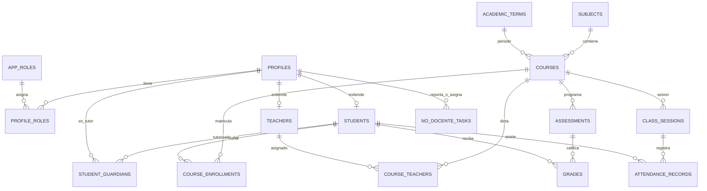

# Modelo de Datos y Persistencia

El sistema utiliza **PostgreSQL** alojado en **Supabase**, aplicando un modelo relacional normalizado con control de concurrencia y políticas estrictas de seguridad a nivel de fila (**Row Level Security - RLS**).

---

## 1. Diagrama Entidad-Relación (ER)

---

## 2. Entidades Principales

### Identidad y Seguridad (RBAC)
- **`public.profiles`**: Tabla maestra de personas (datos biográficos).
  - `id (uuid, PK)`, `auth_user_id (uuid, FK auth.users)`, `first_name`, `last_name`, `dni (unique)`, `email`, `phone`, `birth_date`, `address`, `is_active (boolean)`.
- **`public.app_roles`**: Catálogo de roles del sistema.
  - Códigos: `admin`, `alumno`, `docente`, `tutor`, `no_docente`.
- **`public.profile_roles`**: Asociación many-to-many entre perfiles y roles.
  - `profile_id (FK profiles)`, `role_code (FK app_roles)`.

### Estructura Académica
- **`public.students`**: Atributos específicos del alumno.
  - `id (uuid, PK, FK profiles)`, `file_number (legajo único)`, `enrollment_status`.
- **`public.teachers`**: Atributos profesionales del docente.
  - `id (uuid, PK, FK profiles)`, `file_number (legajo único)`, `specialty`, `hire_date`.
- **`public.student_guardians`**: Vinculación tutor-alumno.
  - `student_id (FK students)`, `guardian_profile_id (FK profiles)`, `relationship_type`.
- **`public.subjects`**: Materias curriculares (ej. Matemática, Lengua, Historia).
  - `id (uuid, PK)`, `code (unique)`, `name`, `description`.
- **`public.academic_terms`**: Ciclos lectivos (ej. Ciclo 2026, Ciclo 2027).
- **`public.courses`**: Instancias de dictado por materia, división y ciclo lectivo.
- **`public.course_teachers`**: Docentes asignados a cada curso, con día y franja horaria.
- **`public.course_enrollments`**: Matrícula formal de los alumnos en los cursos correspondientes.

### Evaluación y Asistencia
- **`public.assessments`**: Evaluaciones programadas (parciales, trabajos prácticos, exámenes finales).
- **`public.grades`**: Calificación numérica o conceptual obtenida por el alumno.
- **`public.class_sessions`**: Registro de clases dictadas con fecha y contenidos.
- **`public.attendance_records`**: Estado de asistencia por alumno (`Presente`, `Ausente`, `Justificado`).

### Módulos Complementarios
- **`public.no_docente_tasks`**: Registro de incidencias y mantenimiento con prioridades y estados.
- **`public.audit_logs`**: Trazabilidad y auditoría de cambios en registros sensibles.
- **`public.contact_messages`** y **`public.inscription_requests`**: Gestión de mensajes públicos y solicitudes web de ingreso.

---

## 3. Políticas de Seguridad (RLS)

PostgreSQL aplica Row Level Security para aislar los datos entre roles:
- **Administrador:** Lectura y escritura irrestricta sobre el catálogo académico y perfiles.
- **Docente:** Lectura y carga de notas y asistencias únicamente sobre los cursos donde tiene asignación activa en `course_teachers`.
- **Alumno:** Lectura exclusiva de sus propias calificaciones, asistencias y materias en las que está matriculado (`course_enrollments`).
- **Tutor:** Acceso de lectura limitado a los registros de aquellos alumnos vinculados en `student_guardians`.
- **No Docente:** Acceso operativo al panel de tareas, avisos y gestión de mantenimiento.

